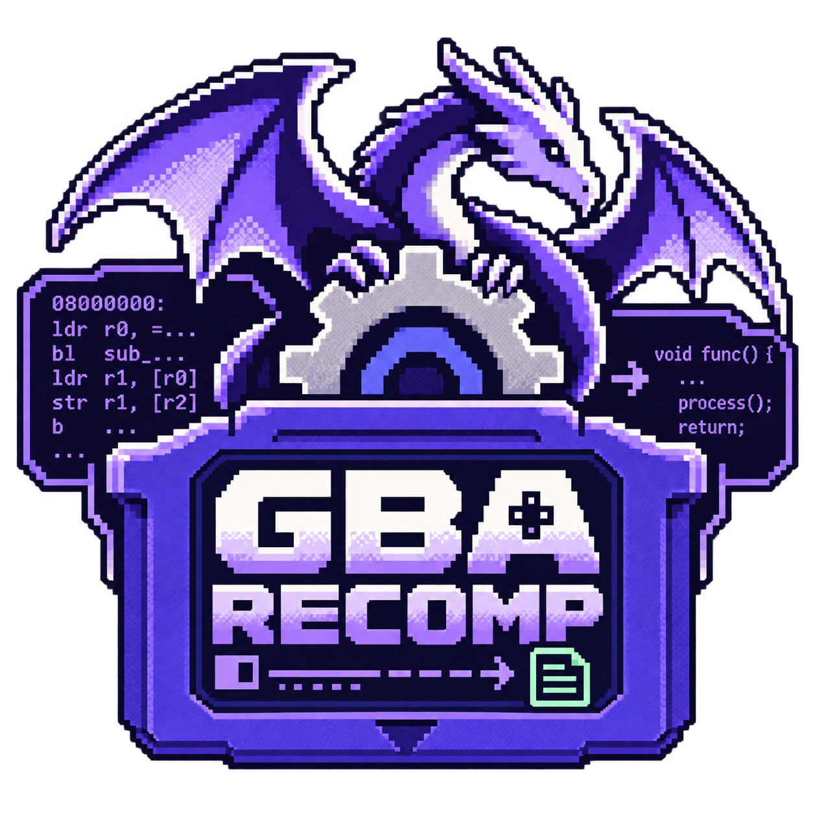

<p align="center">
  
</p>

<h1 align="center">GBA Recomp</h1>

<p align="center">
  A static recompiler for Game Boy Advance games: <b>GBA ROM → LLVM → native executable</b>,<br>
  with a cycle-exact interpreted core as safety net, a desktop frontend, an external settings app and WebRTC party play.
</p>

---

## What it does

`gba-recomp` turns a GBA ROM into a native program for your machine:

1. **Profile** – the game runs in the built-in interpreter (`gba-core`) to discover the code it actually executes, including routines copied to RAM.
2. **Recompile** – every discovered ARM/Thumb run is lowered to LLVM IR and compiled in parallel to machine code for the target.
3. **Link** – the native code is linked with the runtime (`gba-native-rt`): bus, PPU, APU, DMA, timers, IRQ, HLE BIOS, saves, SDL3 frontend.
4. **Verify** – `--verify-interpreter` runs native code and the interpreter side by side and checks registers, cycles and framebuffer every frame.

On *Pokémon LeafGreen* (rev. 1) the recompiled package runs **99.9 % of instructions natively**, stays **cycle-identical** to the interpreter over 3000 verified frames, matches the mGBA reference framebuffer, and runs at ~900 fps headless on an Apple M4.

Code that cannot be translated safely (exception returns, `MSR`, `SWI`, code outside the profile) falls back to a one-instruction interpreter step. Nothing is JIT-compiled. Packages are labelled `aot-compatible`; the experimental `strict-aot` pipeline never falls back to interpretation.

## Features

| Area | Status |
|---|---|
| ARM7TDMI interpreter (ARM + Thumb), bus, scheduler, DMA, timers, IRQ | ✅ 128 unit tests, mGBA differential |
| Software PPU (modes 0–5, sprites, windows, blending, mosaic) and APU (PSG + direct sound) | ✅ |
| HLE BIOS, SRAM / Flash 64K/128K / EEPROM saves | ✅ |
| LLVM native runs, RAM code with content guards, parallel emission | ✅ |
| `bundle`: one executable with the ROM embedded; macOS `.app` | ✅ |
| SDL3 window, audio, keyboard, gamepads (USB/Bluetooth), generic joysticks, GPIO buttons (Linux) | ✅ |
| `gba-settings` (video, audio, controls, GPIO) and native macOS menu bar / context menu | ✅ |
| `gba-party`: WebRTC rooms with text chat (voice, screens and link cable planned) | 🚧 phase 1 |
| Targets: macOS, Linux x86-64/ARM64 (Raspberry Pi, Orange Pi), Windows, iOS, Android, WebAssembly | 🚧 see [platforms](#platforms) |

## Quick start

Requirements: Rust 1.99.0, the LLVM 23.1.3 build pinned in [`toolchain.lock.toml`](toolchain.lock.toml) and SDL3.

```bash
export LLVM_SYS_231_PREFIX=/path/to/LLVM-23.1.3
cargo build --release -p gba-recomp -p gba-native-rt -p gba-settings -p gba-party

# Recompile the free demo game into a self-contained package (ROM embedded)
target/release/gba-recomp bundle --rom games/rkanoid-v3.00.gba --out out/Rkanoid

# Run it (macOS produces out/Rkanoid.app)
open out/Rkanoid.app            # macOS
out/Rkanoid/game                # Linux / Windows
```

Without embedding the ROM (`compile` instead of `bundle`) the package never contains game data and the player supplies the ROM:

```bash
target/release/gba-recomp compile --rom game.gba --out out/game --opt O2 --mode aot-compatible --profile-frames 3000
out/game/game --rom game.gba --save game.sav
```

Useful flags: `--profile-frames N`, `--profile-input FRAME:LEN:KEYS` (script inputs so the profile reaches more code), `--headless --frames N --verify-interpreter`, `--no-splash`.

### Controls

Arrows = D-pad, **Z** = A, **X** = B, **Enter** = Start, **Backspace** = Select, **A/S** = L/R, **Tab** = fast-forward, **F11** = fullscreen, **Esc/F1** = in-window menu, right click = context menu. Everything is remappable in **Settings…** (⌘, on macOS).

## Platforms

| Target | Triple | Status |
|---|---|---|
| macOS (Apple Silicon) | `aarch64-apple-darwin` | ✅ built and verified locally |
| Linux x86-64 | `x86_64-unknown-linux-gnu` | 🚧 CI |
| Linux ARM64 – Raspberry Pi 4/5, Orange Pi | `aarch64-unknown-linux-gnu` | 🚧 CI |
| Windows x86-64 | `x86_64-pc-windows-msvc` | 🚧 CI |
| iOS / iPadOS | `aarch64-apple-ios` | 🚧 in progress |
| Android | `aarch64-linux-android` | 🚧 in progress |
| Web | `wasm32-unknown-emscripten` | 🚧 in progress |

Touch screens get an optional on-screen gamepad. See [SPEC-068](specs/SPEC-068-multiplatform-targets.md) for the target contract.

## Repository layout

| Path | Contents |
|---|---|
| `crates/gba-core` | Interpreted GBA core (CPU, bus, PPU, APU, BIOS HLE, backup) |
| `crates/gba-llvm` | LLVM lowering (native runs, strict-AOT IR) |
| `crates/gba-native-rt` | Runtime linked into recompiled packages |
| `crates/gba-recomp` | CLI: `compile`, `bundle`, `inspect-rom` |
| `crates/gba-desktop` | SDL3 frontend library, settings model, menus, input, GPIO |
| `crates/gba-settings`, `crates/gba-party` | Settings and party companion apps (egui) |
| `crates/gba-net` | WebRTC party sessions |
| `crates/gba-run` | Headless runner for the interpreter |
| `games/` | Freely redistributable games used by demos and CI |
| `specs/`, `adr/`, `knowledge/` | Specifications, decisions and evidence (Portuguese) |

The project follows specification-driven development: every feature has a spec in [`specs/`](specs/README.md) and progress lives in the [ROADMAP](ROADMAP.md). The original Portuguese overview is in [`docs/README.pt-BR.md`](docs/README.pt-BR.md).

## Legal

GBA Recomp contains no Nintendo code or BIOS. Only games whose license allows redistribution may be added to `games/`. Packages produced with `bundle` from commercial ROMs contain the game and are for personal use only.
