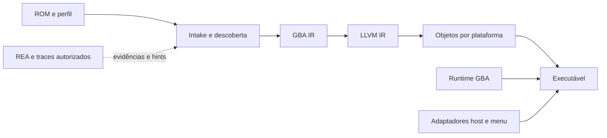

# Arquitetura proposta

## Componentes e fronteiras

| Componente proposto | Responsabilidade | Saída/fronteira |
|---|---|---|
| `gba-image` | ROM, header, identidade, ELF auxiliar | Image imutável e mapa de origem |
| `gba-analysis` | Entradas, CFG, literal pools, tabelas, overlays | Grafo com origem e confiança |
| `gba-armv4t` | Decoder ARM/Thumb restrito ao ARM7TDMI | Instruções sem efeitos host |
| `gba-ir` | Semântica CPU, efeitos, checkpoints | IR própria versionada/verificada |
| `gba-llvm` | Lowering, otimização, emissão | LLVM IR, bitcode e objetos |
| `gba-runtime` | CPU, bus, scheduler, PPU/APU, cartucho | ABI C versionada |
| `gba-compat` | Interpretador opcional para misses | Mesmo estado e scheduler |
| `gba-host` | Tela, áudio, input, storage, clock | Interfaces independentes do SO |
| `gba-ui` | Biblioteca, configuração, diagnósticos | Preferências e comandos |
| `gba-cli` | analyze/profile/build/verify/package | Manifestos e erros estruturados |

Rust é a linguagem escolhida para código próprio, runtime e ferramentas; LLVM é acessado pela API C encapsulada em `gba-llvm`. O baseline fixado para GBA-010 está em [ADR-004](../adr/ADR-004-toolchain-baseline.md) e [toolchain.lock.toml](../toolchain.lock.toml): Rust 1.99.0, LLVM 23.1.3 e `llvm-sys` 231.0.1. A fixture O0/O2 já emite, linka e executa em macOS arm64; Linux x86-64 ainda precisa de validação. Emissão textual serve para inspeção e bootstrap. SDL3 segue como candidato desktop, sem versão escolhida até GBA-070.

O primeiro fluxo ROM→host usa `gba-recomp` para intake/header/SHA-256, descoberta ARM de branches diretos e emissão LLVM de `MOV` imediato, `ADD` imediato, `CMP` imediato e `B`/`BL`. A homebrew Tiny Counter valida esse caminho sem bus; as instruções descobertas viram casos estáticos num dispatcher nativo. Opcode ausente retorna falha de compilação ou `missing_code`, sem interpretação silenciosa. O escopo implementado não cobre as demais responsabilidades desta arquitetura.

## Execução

Um dispatcher usa `(PC, estado ARM/Thumb, identidade do código)` para escolher um bloco nativo. Cada bloco avança estado guest e tempo guest e retorna um motivo de saída. Saltos guest não usam a pilha host como modelo obrigatório; isso permite IRQ, retomada, savestates e chamadas indiretas sem recursão host ilimitada.

O scheduler é a autoridade do tempo. Operações de barramento e instruções têm custos dependentes do estado, incluindo waitstates e DMA. A execução deve alcançar eventos no instante definido pelo modelo, inclusive dentro de blocos longos. PPU/APU usam ciclos guest; áudio e vsync host regulam apresentação, sem redefinir a frequência do GBA.

A baseline visual é PPU por software, com saída 240×160 antes de filtros. GPU host apresenta e filtra o framebuffer. Um renderer mais rápido só substitui o baseline com equivalência demonstrada por fixture, inclusive writes durante a linha.

## AOT e código mutável

`strict-aot` é o modo do pacote Tiny Counter: contém traduções antecipadas, sem compilador em runtime e sem fallback interpretado. Seu conjunto de instruções limitado faz destino desconhecido retornar `missing_code`. O decoder e o mapa do código mutável ainda não existem; essa cobertura faz parte de GBA-025.

`aot-compatible` inclui interpretador e contabiliza instruções interpretadas. Não contém JIT. Serve para descoberta e jogos cujo código não cabe no conjunto AOT conhecido. O rótulo do pacote e o relatório expõem o modo.

Overlays pré-compilados são identificados pelos bytes e pelo endereço de execução. Escritas por CPU, DMA, SWI, loader e restore invalidam código; cópia ROM→RAM não autoriza reutilizar tradução no endereço ROM porque PC-relative, mirrors e timing diferem.

## Portabilidade

Prioridade inicial: Linux x86-64 e macOS arm64; em seguida Windows x86-64 e Linux arm64. Android arm64, iOS arm64 e WebAssembly são expansões condicionadas a adaptadores, toolchains e empacotamento próprios. Consoles e sistemas restritos precisam dos SDKs e acesso do desenvolvedor. A capacidade de emitir um objeto LLVM é apenas uma etapa.

Fontes e justificativas: [KNO-001](../knowledge/KNO-001-evidence.md), [ADR-001](../adr/ADR-001-core-architecture.md), [SPEC-010](../specs/SPEC-010-platform-packaging.md).
